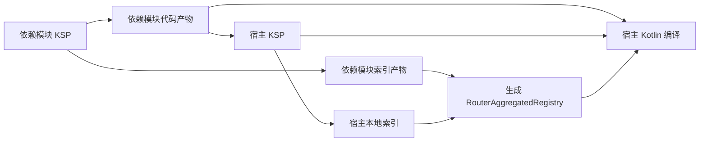

# Router Gradle Plugin 长期架构方案

版本：Router 5.1.0。验证基线：Gradle 9.6.1、Kotlin 2.4.0、AGP 9.2.1、KSP 2.3.10。

## 1. 目标与范围

将构建期聚合改为：**各模块产出显式路由索引，Gradle 按实际依赖和变体选择索引，宿主生成注册入口**。

完成后应当具备以下能力：

- 宿主只聚合自己需要的模块；多 App 工程中的无关模块不进入任务依赖。
- 本地 project、发布到 Maven 的模块、included build 使用同一份索引协议。
- target 名可自定义，Android build type/flavor 沿用正常依赖解析的选择结果。
- 增删路由、改聚合类名、迁移 checkout 目录不会产生旧文件残留或不稳定的模块身份。
- 聚合任务支持 UP-TO-DATE、Build Cache 和 Configuration Cache。
- 保留 `RouterAggregatedRegistry.registerAll()` 及 `Navigator` 的运行时使用方式。

本次架构调整覆盖 `router-gradle-plugin`、`lib_router_ksp` 和 Demo 构建接入。测试 compilation 和动态特性模块独立安装后的发现不纳入支持范围；JS/Wasm 已补充生产 compilation 的索引与聚合支持。

## 2. 改造前的问题

- `RouterPlugin` 遍历 `rootProject.subprojects`，通过 KSP 目录及任务名称寻找模块，没有使用宿主依赖闭包。
- KMP 接入硬编码 Android、JVM、两个 iOS target；纯 Android 分支按宿主 variant 名猜测依赖模块的 KSP 任务名。
- 聚合任务将整个 KSP 源码目录声明为输入，再用正则查找 registry。
- KSP 的模块后缀由源文件绝对路径集合计算，新增文件或改变 checkout 路径会改变生成类名。
- 在当前仓库实测：JVM 聚合任务能够复用配置缓存，重复执行为 UP-TO-DATE；不能将配置缓存列为已知故障。
- 使用当前任务类在临时工程实测：新增无关 KSP 文件会重跑聚合但输出相同；修改 `registryPackage` 后旧聚合文件仍然存在。

已有运行时单测和 Android 真机测试不能替代插件功能测试。本次新增 `router-gradle-plugin/src/test/kotlin`，用独立临时工程运行真实 Gradle、KSP 和编译任务。

## 3. 插件职责

采用两个插件入口，共用内部实现及一个 `router` 扩展：

| 插件 ID | 使用位置 | 职责 |
| --- | --- | --- |
| `io.github.limuyang2.router.module`（新增） | 声明路由或拦截器的业务模块 | 注入稳定模块 ID、连接 KSP、规范化本模块索引、提供索引产物 |
| `io.github.limuyang2.router`（保留） | 实际执行统一注册的宿主 | 自动应用 module 插件，并消费依赖索引、生成总入口 |

普通无路由模块不需要应用插件，也不需要提供空索引。**宿主自身可能有路由**，它的本地索引通过自身 TaskProvider 直接接入，不通过对自己的依赖解析获取。

KSP 插件版本仍由使用方统一管理。module 插件检查所需 KSP 配置并给出明确错误，避免隐式切换使用方的 Kotlin/KSP 版本。首版保留显式添加 processor 依赖的方式，先完成聚合架构，不同时引入依赖版本管理机制。

内部按职责划分为索引读写、模块身份、KSP 接入、平台适配、索引发布与解析、聚合生成。先作为同一 Gradle 插件工程中的独立类维护，不预先拆分多个发布包。

## 4. 索引协议与模块身份

每个参与的生产 compilation/variant 输出独立的 `router-index.json`，UTF-8、固定字段顺序和换行格式。例如：

```json
{
  "schemaVersion": 1,
  "registryApiVersion": 1,
  "moduleId": "com.example:feature-home",
  "registries": [
    "com.example.home.generated.ModuleRouterRegistry_0123456789abcdef01234567"
  ]
}
```

示例后缀仅用于展示格式。正式后缀取经过校验的 `moduleId` 的 SHA-256 前 24 位十六进制字符，不再读取源码路径集合。`moduleId` 默认从 `project.group:project.name` 推导，group 为空时只使用项目名；通过惰性 convention 读取构建脚本配置，显式 `router.moduleId` 优先。它不读取单独修改的 Maven publication 坐标，不包含版本号、target 或文件系统路径。

应在 settings 中固定 `rootProject.name`，避免 Gradle 的默认项目名/group 随 checkout 目录改变。项目/group 改名会改变推导值，需要保持原身份时显式设置。无法推导出合法 ID 时，配置阶段报错并提示手动覆盖，不进行可能引入冲突的字符替换。

同一逻辑模块不同平台/Android 变体可使用相同的 registry 类名；具体内容由所选变体决定。不同模块的推导 ID 可以自然区分；同名同 group 的项目或组合构建发生冲突时，通过显式 moduleId 区分。

协议约定：

- 索引只声明本模块入口，不把传递依赖合并进索引；依赖拓扑由 Gradle 提供。
- 索引不包含时间戳、绝对路径、随机数、源文件内容和构建机器信息。
- KSP 原始资源使用 `META-INF/io.github.limuyang2.router/<moduleId哈希>/router-index.json`。KSP 会把资源带入 JVM/Android 代码产物，模块独立路径避免 APK 合并时出现同名资源冲突；Gradle 消费的独立索引仍来自 Prepare 任务。
- 已应用 module 插件但本次没有路由时，规范化产物为 `registries: []`。
- 同一个组件通过菱形依赖重复到达时只注册一次；不同组件使用相同 moduleId 或入口类名时构建失败，输出组件来源。moduleId 冲突会提示在其中一个生产模块使用 `router { moduleId.set("com.example:feature-home") }` 覆盖，并重新构建或发布；不通过静默加后缀改变身份。
- 未支持的 schema/API 版本、损坏索引、不合法的 Kotlin 包名和类名都在构建期报错。
- schema 版本与插件发布版本独立管理；只为影响协议解释的变化升级 schema。

## 5. KSP 生成生命周期

KSP 继续生成 `ModuleRouterProvider_*` 和 `ModuleRouterRegistry_*`，同时使用 CodeGenerator 输出索引资源；不在 Gradle 插件中反向解析 Kotlin 源码。

生成过程跨轮次只累计不可变模型，保留 deferred symbols，在 `finish()` 一次性输出完整 provider、registry 和索引。每轮在符号仍然有效时通过 `CodeGenerator.associate/associateByPath` 登记输入依赖，不保存 KSFile 到下一轮；最终使用 aggregating Dependencies 标记新增输入也会使结果失效。真实 KSP 2.3.10 测试覆盖后续生成的路由、延迟解析的类型，以及最终源码参与编译。该行为不视为其它 KSP 版本的兼容保证。KSP 的多轮处理契约见[官方说明](https://kotlinlang.org/docs/ksp-multi-round.html)。

模块 provider、registry 和索引都是聚合产物，应声明正确的 aggregating 源依赖；单页面实例工厂维持独立的生成依赖。必须测试新增路由、删除最后一个路由、无源文件导致 KSP NO-SOURCE、增量重编译及其它处理器在后续轮次新增路由。相关规则见 [KSP 增量处理](https://kotlinlang.org/docs/ksp-incremental.html)。

源码关联仅合并当前轮次路由/Entry、全局 Push/Pop 拦截器、页面 Push/Pop 拦截器处理结果中的依赖文件，不再使用 `Resolver.getAllFiles()` 关联整个源码集合；通过类型解析到达的依赖由 KSP 追踪。保留 `aggregating = true`，所以普通文件变化仍可能触发模块级路由处理，优化目标是避免把其它无关源码一起拉入 dirty set。真实增量测试检查这一范围，并将路由增删改名、空模块恢复、跨 source set 拦截器重绑定、Entry 变化、父类型变化及多轮生成的输出与干净构建比较。

`PrepareRouterIndexTask` 只读取约定的本地索引资源并写入自己的输出目录，承担协议验证、规范化及无路由情况下的空索引。它不能掩盖 KSP 失败；删除最后一个路由后不得复用旧索引，也不能主动改写 KSP 自己管理的输出。

## 6. Gradle 产物交换与依赖边界

### 6.1 生产端

module 插件为每个受支持的代码变体提供对应的可消费索引 variant，产物来自 `PrepareRouterIndexTask` 的输出 Provider。依赖关系通过产物自动携带，不访问其它 Project 的任务或 build 目录。

索引 variant 使用专用用途属性，并携带与代码变体一致的平台、Native target、Android build type/flavor 等选择属性。自定义的本地 target 名不能成为跨模块必须相等的匹配条件，例如宿主的 `desktop` 应当能消费依赖的 `jvm`。

代码变体使用 `io.github.limuyang2.router.index-schema=1` 标记参与索引协议。伴随产物采用 outgoing secondary variant，属性为 `category=documentation`、`docstype=router-index`、`artifactType=router-index`，保留代码变体的其它选择属性。普通代码消费者请求 `category=library`，不会把索引选成代码。

KGP 2.4 会创建 `*-published` 配置副本；AGP 9.2 的普通 Android 库使用 `<variant>Variant<Component>ApiPublication/RuntimePublication`。适配器在本项目的实际 target/component 回调中为这些副本添加标记和索引，保持 AGP 单变体发布省略 flavor/build-type 属性的行为。这些版本相关命名约定集中在 `RouterModulePlugin.kt`，升级构建工具时必须重新运行发布消费测试。

### 6.2 消费端

1. 以宿主当前 compilation 的正常编译依赖解析结果为基础，保留已经选定的组件、版本、替换规则和变体关系。
2. 从其中识别提供 Router 索引的组件；普通依赖不参与索引解析。
3. 仅为这些组件解析对应索引，并与宿主本地索引合并。
4. 将索引文件作为聚合任务的输入。整个过程惰性接入，配置阶段不提前遍历解析文件或实现跨项目回调。

不能重新创建一条无约束的依赖链，再用专用 Usage 解析所有依赖：这会要求普通库也提供路由变体，并可能改变已选择的版本。应利用已有组件图取得伴随产物，这是 Gradle 推荐的[跨项目产物共享方向](https://docs.gradle.org/current/userguide/how_to_share_outputs_between_projects.html)。

本地组件从已经选定的代码 configuration 选择 secondary variant；Maven 的 secondary variant 在 GMM 中成为顶层 variant，因此外部组件使用 `ArtifactView.withVariantReselection()`，显式复制原配置的平台与变体约束，再覆盖索引用途。两种视图使用同一份代码依赖图，不重新选择组件版本。该 API 不会自动沿用原配置的属性。也不能用全局 `lenient = true` 吞掉索引下载、损坏或匹配失败；[Artifact Views 文档](https://docs.gradle.org/current/userguide/artifact_views.html)明确区分了重新选择和宽松解析的行为。

**静态调用需要编译可见性。** 只存在于 runtimeOnly，或被中间模块 implementation 隐藏的 registry，不能直接生成到宿主源码中。对有运行时依赖图的平台，比较路由参与组件的编译/运行时可见性，发现此类路由时报错并提示：宿主显式声明该模块依赖，或通过上游 api 暴露。首版不通过偷偷扩大宿主编译 classpath 来修补可见性。

KMP Native 的可见性以实际 compilation/link 模型验证，不能照搬 JVM configuration 名称。没有可用可见性校验的适配器不得宣称支持自动聚合隐藏的传递路由。

### 6.3 跨仓库发布

本地 project 和 Maven 模块使用相同 JSON 协议。外部自动发现要求发布索引产物及正确的 Gradle Module Metadata，验证 KMP 根坐标到平台组件的选择关系。

只包含旧 provider/registry 的 JAR、AAR 或 KLIB 不自动变成新协议模块。迁移时需要重新发布，或在宿主初始化中显式注册旧模块。文档需明确无法自动识别没有索引标记的历史模块；不能承诺把所有未知普通依赖与旧路由库自动区分开。

## 7. 平台接入与任务顺序

按实际模型发现生产 compilation，而非固定注册四套字符串：

| 适配器 | 首版范围 | 要验证的边界 |
| --- | --- | --- |
| Kotlin JVM | 默认和自定义 target 名 | main 的编译任务、KSP 产物及依赖可见性 |
| Android Application/Library | debug/release、flavor | 不同模块的变体匹配、fallback、缺失维度 |
| Android KMP Library | 当前工程使用的 Android KMP 插件 | AGP/KGP 提供的模型与普通 Android variant 模型差异 |
| Kotlin Native | iosArm64、iosSimulatorArm64 | 每个平台的索引、编译输入和 framework 链接 |
| Kotlin Web | js、wasmJs | 每个 target 独立 KSP、匹配本地和发布索引、浏览器运行 |

不支持的平台给出明确诊断，不生成没有使用者的任务。AGP、KGP、KSP 的 API 差异封装在适配器中；必要的版本相关约定集中维护并有兼容性测试。



禁止出现“宿主 KSP 依赖宿主聚合任务”的反向边。Kotlin JVM/KMP（含 Android KMP 和 iOS）通过 KGP 2.4 的 `compilation.defaultSourceSet.generatedKotlin` 登记聚合输出，让 IDE 和编译器都能识别；目录不加入 KSP 2.3.10 读取的 `sourceSet.kotlin`。普通 AGP Application/Library variant 保留编译任务接入，因为其 variant 源码目录也会成为 KSP 输入。回归测试覆盖首次编译、源码模型、KSP 输入与任务依赖，以及聚合入口改名后 KSP 保持 UP-TO-DATE。

## 8. 聚合任务与缓存

`GenerateRouterAggregateTask` 仅接收索引文件、聚合包名/类名和代码生成协议版本。确定性排序、校验去重后生成一个入口文件，不扫描源码树，不读取 Project 模型。

- 任务声明精确索引输入，使用 `PathSensitivity.NONE` 排除路径对缓存的影响；输出不记录索引所在机器路径。
- 同一个 compilation 拥有独立输出目录。改包名或类名时只清理该任务拥有的旧输出。
- 配置不变且索引内容相同，重复构建应为 UP-TO-DATE；其它处理器的输出变化不触发聚合。
- 生成内容相同不重写文件；在验证搬迁目录后的输出一致性后启用 `@CacheableTask`。
- Configuration Cache、输出 Build Cache、Isolated Projects 分别验证，不把其中一项通过当成另外两项通过。整体第三方插件兼容性与 Router 自身兼容性分开报告。

## 9. 接入方式与迁移

以下 DSL 已实现；业务模块新增 module 插件，moduleId 默认自动推导、允许覆盖，原有按 target 添加 KSP processor 的方式保留：

```kotlin
// 业务模块
plugins {
    id("io.github.limuyang2.router.module")
    // 原有 Kotlin、平台插件、KSP 插件保持由工程管理
}
router {
    // 可选：覆盖默认 group:name，解决冲突或固定模块身份。
    moduleId.set("com.example:feature-home")
}

// 宿主模块：宿主插件自动包含本模块的生产端能力
plugins {
    id("io.github.limuyang2.router")
}
router {
    registryPackage.set("com.example.generated")
    registryName.set("RouterAggregatedRegistry")
}
```

宿主的 `registryPackage`/`registryName` 继续控制总入口；业务模块的 registry 包名继续对应 KSP 的 `router.registryPackage`，两者不能混为同一项设置。

这次改造随 5.1.0 提供，改变构建接入及索引协议。迁移时同时升级 runtime、processor 与插件至 5.1.0，重新构建/发布路由模块。保留注册函数调用形态，移除全工程扫描的实现，不引入永久维护的双聚合通路；自定义 Pop 拦截器按 README 的迁移说明调整。

仓库 Demo 首先迁移 composeApp；androidApp、desktopApp、iosApp 继续调用共享宿主入口，避免在多个宿主层重复应用聚合插件。新旧索引命名切换以及第一次升级必须有清理旧产物的迁移步骤。

仓库另有三个可运行的 KMP 示例模块：`demo-feature-product`、`demo-feature-account` 使用默认 moduleId，均通过 `api` 依赖手动覆盖 moduleId 的 `demo-feature-shared`。composeApp 只直接依赖前两个模块，验证真实菱形依赖；各平台生成的聚合包含宿主与三个业务模块，shared 只有一个注册调用。首页提供商品和账户入口，帮助页同时支持实例/URL 跳转并返回共享结果类型。`composeApp/src/jvmTest/` 验证真实 KSP 产物的路由映射、参数和结果，Android 入口流程复用现有 `PopNavigationDeviceTest` 初始化环境。

## 10. 实施阶段与发布验收

以下阶段都通向同一长期架构，不先开发一套临时目录扫描优化方案：

| 阶段 | 交付内容 | 完成条件 |
| --- | --- | --- |
| 1. 产物机制验证 | 用 TestKit 最小工程验证伴随索引 variant、参与标记、普通依赖排除、编译可见性、版本选择及本地 Maven 发布 | 正常代码解析结果不变，索引与选中代码组件/变体一致；无法满足时先修订产物接入设计 |
| 2. 协议与 KSP | 稳定 moduleId、registry 名、索引读写、正确的多轮和增量输出 | 新增/删除路由及跨 checkout 生成结果测试通过 |
| 3. 生产端与 JVM 宿主 | module 插件、索引发布、依赖消费、宿主本地索引、缓存任务 | 自定义 JVM target、多模块和发布消费形成完整闭环 |
| 4. Android 与 iOS | 普通 Android、Android KMP、两个 iOS 适配器，Demo 迁移 | clean 编译、Android 组装、iOS framework 链接、无 KSP 循环依赖 |
| 5. 发布收尾 | 迁移文档、兼容矩阵、诊断、旧聚合通路移除 | 全部验收用例通过后发布 |

必须进入自动化的用例：

- 宿主自身有/无路由；直接依赖、传递 api 依赖、菱形依赖、隐藏的 implementation 路由及无关 App。
- 普通库没有索引；带标记但缺失索引；损坏索引、重复 moduleId/类名、未知协议版本。
- 不同组件版本冲突和 dependency substitution；included build；本地 Maven 仓库中的 JVM、Android、KMP 平台产物。
- 自定义 target 名；Android flavor/build type 不同名但兼容的选择；不兼容变体必须清晰失败。
- 无变化第二次构建；修改无关 KSP 文件；新增/删除最后一个路由；修改包名、类名；不同 checkout 路径；删除输出后从 Build Cache 恢复。
- 清理后单独执行 KSP、单独执行聚合、完整编译及并行构建，不出现任务环或读取尚未生成的文件。
- 在支持版本矩阵内验证 Configuration Cache；单独检查 Router 是否仍访问其它 Project 的可变模型。
- Android Demo 安装启动并确认跨模块注册；既有运行时单测和真机关键导航流程继续通过。

发布前不承诺未经测试的 Gradle/AGP/Kotlin/KSP 版本组合。首批以当前仓库版本作为基准，后续扩展兼容矩阵；测试所需的 Maven 发布使用临时本地仓库，不依赖私有发布凭据。


## 11. 首版验证与剩余范围

`./gradlew :router-gradle-plugin:test` 包含协议单测和真实 TestKit 构建。已覆盖：

- 本地直连、传递、菱形、无关模块排除，runtimeOnly 不可见性诊断，included build 的版本替换。
- JSON 协议/名称校验、缺失索引、重复模块/入口、空索引、改入口名清理旧文件。
- moduleId 默认推导、空 group、脚本中配置 group、非法 ID 提示、显式覆盖及覆盖后清理旧注册类；推导冲突报出双方来源，覆盖并重新发布后恢复聚合。
- 无变化 UP-TO-DATE、Configuration Cache 重用、无关文件不触发聚合、跨 checkout 的 Build Cache 恢复。
- 自定义 JVM target，真实 KSP 多轮/延迟符号、删除最后一个路由和 NO-SOURCE。
- 独立 Kotlin JVM、KMP 根坐标重定向、iOS 本地与 Maven 消费，Android flavor/build-type fallback、APK 打包、AAR 发布和 Android KMP 发布消费。

Android 集成测试需要本地 Android SDK 36；iOS 集成测试只在 macOS 运行。测试使用临时本地 Maven 仓库，不读取私有发布凭据。共享协议源码位于 `router-index-protocol/`，分别编入 processor 与 included-build 插件，避免引入两套 schema 实现或循环构建依赖。

5.1.0 没有承诺 Isolated Projects、其它构建工具版本组合、JS/Wasm、test compilation、动态 feature 安装后的发现，也没有检测未携带索引标记的旧库。后续版本仍需扩展版本矩阵与不同 Android 发布组合的覆盖；现有实现保留错误即失败的索引校验，不回退到目录扫描。


2026-09-07 本地验收结果：19 项插件/协议测试、42 项运行时 JVM 单测、8 项 Android 真机导航测试全部通过，无跳过。`validatePlugins`、Demo JVM/Android/两个 iOS 编译、Android APK 组装和 iOS Simulator framework 链接检查通过。真机第一次运行因设备休眠出现无 Compose 层级错误，唤醒后两次完整重跑通过，临时亮屏设置已恢复。未做 iOS 真机/UI 测试。

同日增加 moduleId 默认推导后，插件/协议测试扩展至 23 项并全部重跑通过，无跳过；再次通过 `validatePlugins`、Demo JVM/Android/两个 iOS 编译、APK 组装和 iOS Simulator framework 链接。Demo 已移除显式 moduleId，四个目标的索引均为 `library-router:composeApp`。本次构建配置调整未重跑运行时单测及真机测试。

随后接入三个实际示例模块：新增 3 项 Demo JVM 集成测试通过，真机导航测试由 8 项扩展为 10 项并全部通过；JVM/Android/两个 iOS 编译、APK 与测试 APK 组装、iOS Simulator framework 链接通过。四个目标均核对到四个不同的模块注册调用，shared 无重复；真机已检查商品、帮助及回传结果页面。新用例复用既有导航测试初始化流程，避免进程级 Navigator 在测试拦截器注册前创建；临时亮屏设置恢复为原值 0。

收窄 KSP 源码关联后，插件/协议测试共 28 项全部通过，其中新增 4 组真实增量场景。对照测试确认修改工具函数时，另一无关源码不再进入 dirty set；增量产物与干净构建一致。四个平台 KSP 重新执行，既有示例输出保持不变，编译和 APK 构建通过；3 项 Demo JVM 测试与 10 项 Android 真机测试重新执行通过，无跳过。真机临时亮屏设置恢复为 0；本次未测量新旧构建耗时差异。
